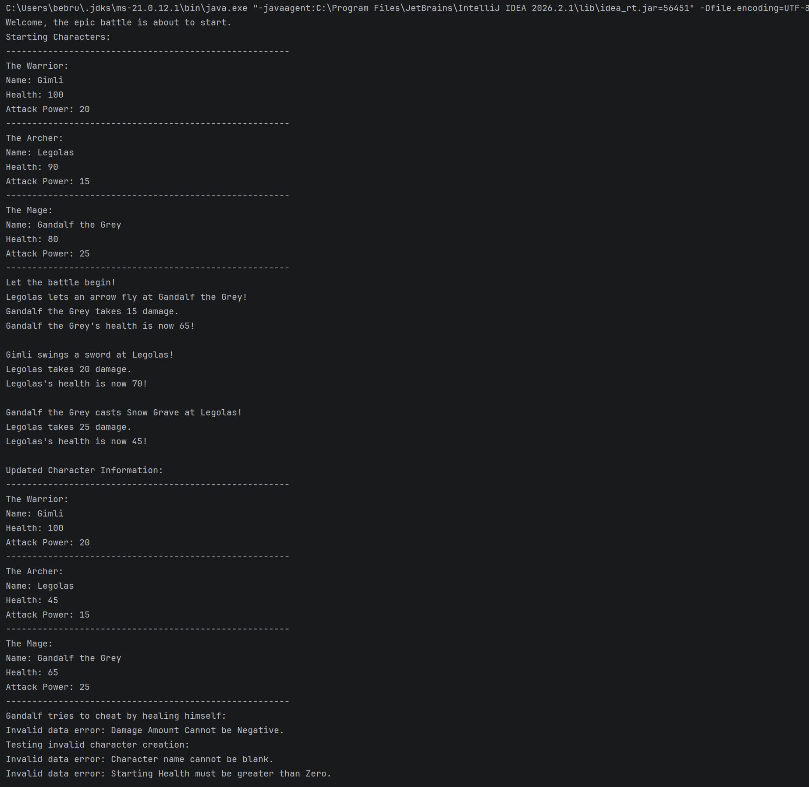

# Game Character Battle System

## Description

This Java program demonstrates inheritance, method overriding, and exception handling through a simple game character battle system.

The program includes a parent `GameCharacter` class and three subclasses:

- `Warrior`
- `Mage`
- `Archer`

Each subclass has its own attack behavior while still using the shared properties and methods from `GameCharacter`.

## Features

- Creates multiple game character types
- Uses inheritance with `extends`
- Uses `super()` in subclass constructors
- Overrides the `attack()` method
- Tracks health and attack power
- Prevents invalid character data
- Prevents invalid damage values
- Uses `try` and `catch` blocks to handle exceptions
- Demonstrates character attacks and health changes

## Required Classes

- `GameCharacter.java`
- `Warrior.java`
- `Mage.java`
- `Archer.java`
- `Main.java`

## How to Run

1. Open the project in IntelliJ IDEA.
2. Open `EpicBattle.java`.
3. Run the `EpicBattle` class.
4. View the battle output in the Run console.

## Screenshot

